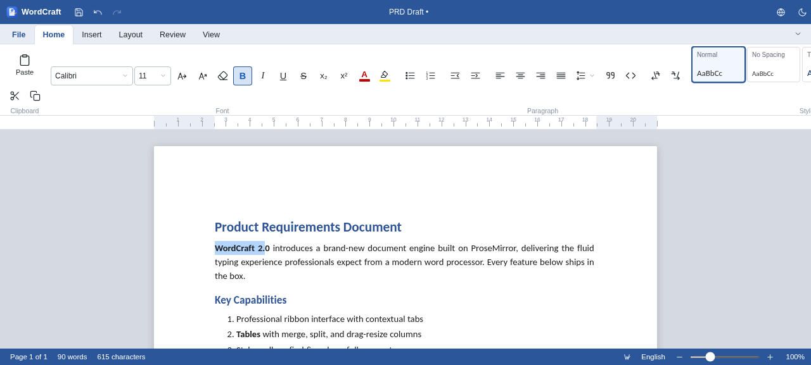
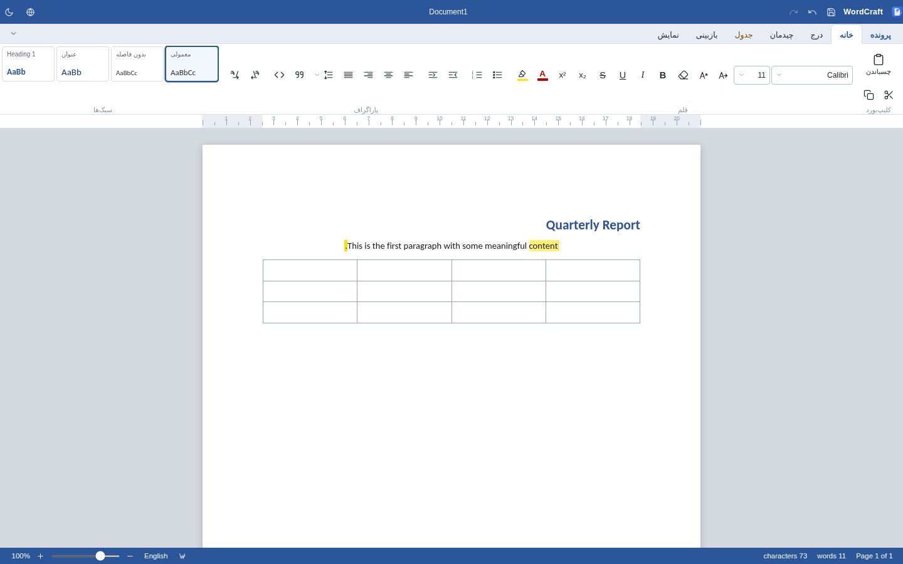
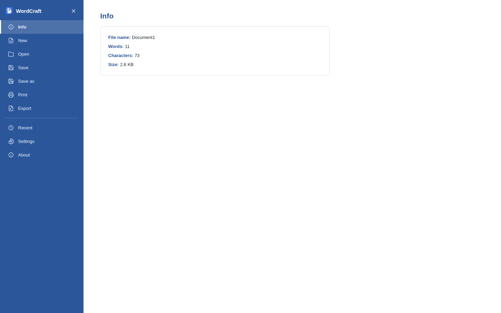

# WordCraft

**WordCraft** is a full-featured word processor with a professional Microsoft Word–style ribbon interface, built on the TipTap (ProseMirror) document engine.

## ✨ Features

- **Professional ribbon** — File (backstage), Home, Insert, Layout, contextual Table tab, Review, View
- **Reliable document engine** — ProseMirror-based typing, selection, and undo/redo
- **Rich formatting** — fonts, sizes, colors, highlight, bold/italic/underline/strike, sub/superscript
- **Styles gallery** — Normal, No Spacing, Title, Heading 1–3, Quote, Code
- **Tables** — grid picker, row/column ops, merge & split, header rows, drag-resize columns
- **Images** — file/URL insert, paste screenshots, drag-corner resize
- **Find & Replace** — live match count, match case, whole words, replace all
- **Page setup** — A4/Letter/Legal, portrait/landscape, margin presets + custom, page color
- **Navigation pane** — clickable heading outline, ruler, zoom 50–250%
- **Review** — spellcheck, word-count statistics, read aloud
- **Bilingual** — per-paragraph LTR/RTL for mixed-language documents
- **Files** — autosave, recent documents, `.doc`/`.html`/`.txt`/PDF export, native `.wc.json`
- **8 UI languages** — English (default), فارسی, العربية, 中文, Español, Français, Deutsch, Русский — with automatic RTL

## ⬇️ Downloads

Grab the latest build for your platform from the [**Releases**](https://github.com/obsifox/wordcraft-releases/releases) page:

| Platform | File |
|----------|------|
| Windows 10/11 | `WordCraft-Setup-x.y.z.exe` (installer) · `WordCraft-Portable-x.y.z.exe` (portable) |
| Linux | `WordCraft-x.y.z-x86_64.AppImage` · `wordcraft_x.y.z_amd64.deb` |
| Android | `WordCraft-vx.y.z-android.apk` |

SHA-256 checksums are published with every release (`SHA256SUMS-*.txt`).

## 🖥️ Screenshots

| | |
|---|---|
|  |  |

## 🔗 Source

Source code (private): https://github.com/obsifox/wordcraft

## 📄 License

MIT © 2026 obsifox
