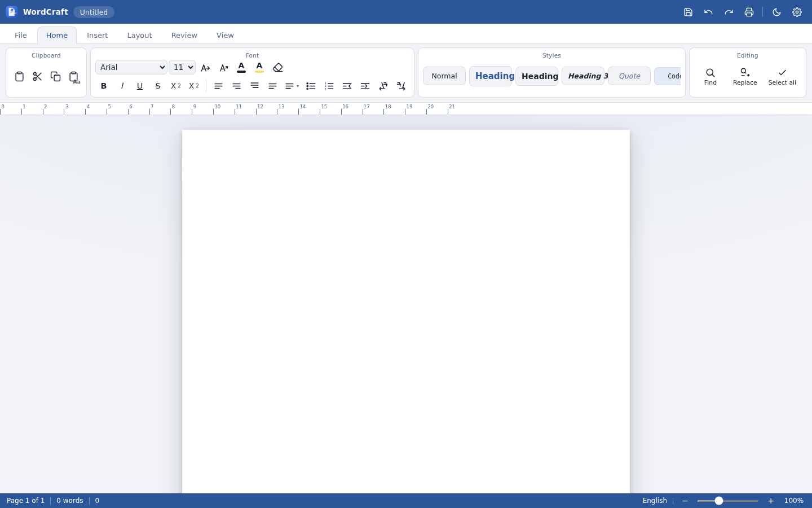

<p align="center"></p>

<h1 align="center">WordCraft — Downloads</h1>

<p align="center"><b>Official builds &amp; releases of WordCraft</b> — a full-featured word processor with a professional ribbon interface.<br>
English by default, switchable to 7 more languages from Settings.</p>

<p align="center">
  <a href="https://github.com/obsifox/wordcraft-releases/releases/latest"></a>
  <a href="https://github.com/obsifox/wordcraft-releases/releases"></a>
  
  
</p>

> 🔒 Source code (private): [obsifox/wordcraft](https://github.com/obsifox/wordcraft)

## ⬇️ Download the latest version

**[→ Go to Releases page](https://github.com/obsifox/wordcraft-releases/releases/latest)**

| Platform | File | Type |
|----------|------|------|
| 🪟 **Windows 10/11 (x64)** | `WordCraft-Setup-<ver>.exe` | Installer (NSIS) |
| 🪟 Windows portable | `WordCraft-Portable-<ver>.exe` | Single file, no install |
| 🐧 **Linux (x64)** | `WordCraft-<ver>-x86_64.AppImage` | Universal (chmod +x and run) |
| 🐧 Debian / Ubuntu | `wordcraft_<ver>_amd64.deb` | Package |
| 🤖 **Android 7+** | `WordCraft-v<ver>-android.apk` | Debug-signed APK |

Verify integrity with the `SHA256SUMS.txt` file attached to every release.

## 📥 Installation notes

### Windows
1. Download `WordCraft-Setup-<ver>.exe` from the [latest release](https://github.com/obsifox/wordcraft-releases/releases/latest).
2. Run the installer. *Note:* the build is not code-signed, so Windows SmartScreen may show a warning — click **More info → Run anyway**.
3. Or grab the portable `.exe` — no installation needed, just run it.

### Linux
```bash
# AppImage (universal)
chmod +x WordCraft-<ver>-x86_64.AppImage
./WordCraft-<ver>-x86_64.AppImage

# Debian / Ubuntu
sudo dpkg -i wordcraft_<ver>_amd64.deb
```

### Android
1. Download `WordCraft-v<ver>-android.apk` on your device.
2. Allow **Install unknown apps** for your browser/file manager (Android blocks unsigned stores by default).
3. Open the APK and install. *(Debug-signed build — Play Protect may ask for confirmation.)*

## ✨ What is WordCraft?

- **Professional ribbon menu** — File / Home / Insert / Layout / Review / View + contextual Table tab
- Rich text: fonts, sizes, colors, highlight, sub/superscript, styles gallery (Headings, Quote, Code)
- Paragraph tools: alignment, line spacing, bullets/numbering, indent, LTR/RTL direction
- **Tables** with add/delete rows & columns and header row
- Insert: pictures (file/URL), links, horizontal line, page break, date & time, symbols, emoji
- Page setup: A4/Letter/Legal/A5, margins, portrait/landscape, 1–3 columns, page color
- Find & replace (match case, whole words), word count & reading time, read-aloud, spellcheck
- True-to-print page canvas with header/footer, print & PDF export, Word (.doc)/HTML/TXT save
- **Autosave**, recent documents, dark mode, focus mode, zoom 50–200 %
- **8 languages**: English (default) · فارسی · العربية · 中文 · Español · Français · Deutsch · Русский — with automatic RTL support

## 🖼 Screenshots



*WordCraft running in a browser / Electron — light theme, English (default). Also available: dark mode, RTL (Persian/Arabic) and 5 more interface languages.*

## 🚀 Releases feed

New release is published automatically on every update pushed to the source repository.


